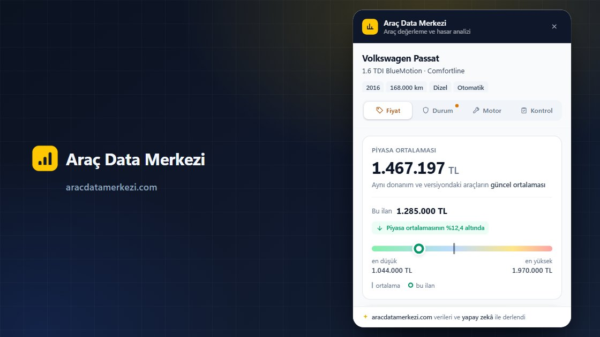
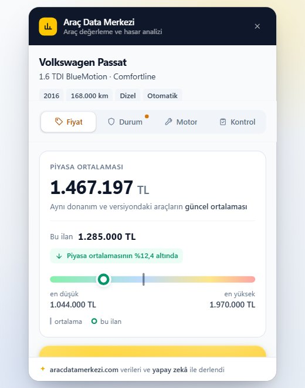
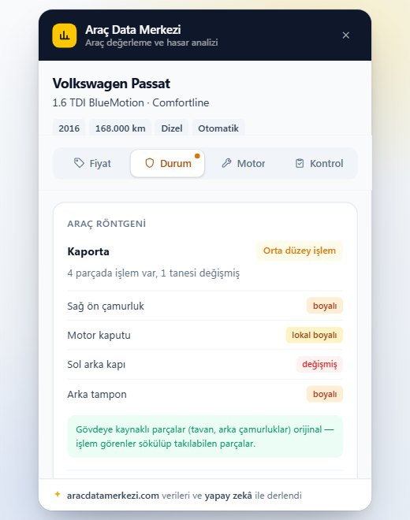

# Araç Data Merkezi: Sahibinden İlanları için İkinci El Araç Değerleme ve Hasar Kontrolü

Araç Data Merkezi, Türkiye için hazırlanmış ücretsiz bir Chrome eklentisidir. Sahibinden'de bir otomobil ilanı açtığınızda sayfanın içinde bir panel açılır ve o aracın piyasada gerçekte ne kadar ettiğini gösterir. Kopyala yapıştır yok, sayfadan çıkmak yok.

*English: a free Chrome extension for Turkey that shows a used car valuation panel on Sahibinden listings. The interface is in Turkish and the valuation is based on the Turkish used-car market.*

**[Install from the Chrome Web Store](https://chromewebstore.google.com/detail/khjccfkimgphbfgljnnhiifgkaodfjeo?utm_source=github&utm_medium=readme&utm_campaign=arac_data_merkezi)** | **[Full guide and FAQ](https://www.addonschrome.com/extensions/arac-data-merkezi-used-car-valuation-damage-check-for-sahibinden.html?utm_source=github&utm_medium=readme&utm_campaign=arac_data_merkezi)** | **[Video demo](https://www.youtube.com/watch?v=ji1o7DF_amQ)**

This repository is the public home for Araç Data Merkezi documentation, release notes and the issue tracker. The extension itself is distributed through the Chrome Web Store.

## Ne gösterir?

- **Piyasa ortalaması:** aynı donanım ve aynı versiyondaki araçların ortalama fiyatı. 1.4 ile 1.6 aynı araç sayılmaz.
- **Hasar ve boya etkisi:** boyalı ve değişen parçaların fiyatı nasıl değiştirdiği, kalem kalem
- **Motor bilgisi:** o motor ailesinin bilinen kronik sorunları
- **Kontrol listesi:** aracı görmeye gitmeden önce bakılacaklar
- Emin olmadığında rakam uydurmaz, sessiz kalır
- Yalnızca açtığınız ilanı okur

## Nasıl kullanılır?

1. Eklentiyi [Chrome Web Mağazası](https://chromewebstore.google.com/detail/khjccfkimgphbfgljnnhiifgkaodfjeo?utm_source=github&utm_medium=readme&utm_campaign=arac_data_merkezi) üzerinden kurun.
2. Sahibinden'de bir otomobil ilanı açın.
3. Panel ilan sayfasının içinde açılır. Fiyat, Durum, Motor ve Kontrol sekmelerine bakın.

Ayrıntılı anlatım ve sık sorulan sorular [eklenti sayfasında](https://www.addonschrome.com/extensions/arac-data-merkezi-used-car-valuation-damage-check-for-sahibinden.html?utm_source=github&utm_medium=readme&utm_campaign=arac_data_merkezi).

## Kimler için?

- İkinci el araba almak isteyen ve ilan fiyatının piyasaya göre nerede durduğunu görmek isteyenler
- Aracını satacak olan ve doğru fiyatı arayanlar
- Galeriler ve alım satım yapanlar

## Ücret

Ücretsizdir. Kurun, çalışır.

## Sınırlar

Eklenti yalnızca Türkiye'deki ikinci el araç piyasası için hazırlanmıştır ve arayüzü Türkçedir. Gösterilen değerler bilgi amaçlıdır; ekspertiz raporunun yerini tutmaz.

## Screenshots

## Support and feedback

Found a bug or want a feature? [Open an issue](../../issues) in this repository. Please include your Chrome version and the steps that led to the problem.

## Disclaimer

Araç Data Merkezi bağımsız bir araçtır; sahibinden.com ile bir bağlantısı, ortaklığı veya sponsorluk ilişkisi yoktur. Marka adları sahiplerine aittir. / Araç Data Merkezi is an independent tool and is not affiliated with sahibinden.com.

---

Built and maintained by [Addons Chrome](https://www.addonschrome.com/?utm_source=github&utm_medium=readme&utm_campaign=arac_data_merkezi).
